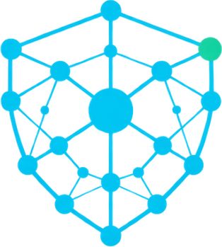
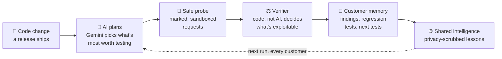

<div align="center">

<picture>
  <source media="(prefers-color-scheme: dark)" srcset="pitch/logo/logo-full.png">
  
</picture>

# SwarmShield

**A security team of one gets a swarm.**

Continuous, simulated pentesting for every release: an AI plans what to test, safe probes run
it, a deterministic verifier decides what's real, and every lesson makes every customer safer.


Built at **SpeedHacks** · SF Tech Week · October 11, 2026

[Quickstart](#-quickstart) · [How it works](#-how-it-works) · [Repo map](#-repo-map) · [Safety model](#-safety-model) · [Status](#-status)

### 📄 Judges: [**open the pitch deck (PDF)**](https://github.com/Anika-Lakhani/speedhacks-hackathon26/raw/feat/ato-response/SwarmShield-Pitch.pdf)

<sub>Or [view it on GitHub](https://github.com/Anika-Lakhani/speedhacks-hackathon26/blob/feat/ato-response/SwarmShield-Pitch.pdf) · 8 slides</sub>

</div>

---

## ✨ Why

You just closed your first enterprise deal, and their security team sends a 200-question
questionnaire. A traditional pentest has weeks of lead time and tests one snapshot of your code.
SwarmShield tests **every release**, in minutes, and **learns across customers** without
sharing anyone's data.

## 🔁 How it works



> **AI decides what to test. Code decides what's real.** The planner only picks scenario IDs
> from a catalog; a deterministic verifier checks every result against the scenario's security
> invariant before anything counts as a finding.

**The self-improving loop, in one example:** customer-a ships a change that breaks order
ownership. SwarmShield confirms an IDOR, records it in `customer-a.md` with a regression test,
and generalizes it into a tenant-neutral lesson. On customer-b's next run, the planner already
knows to check object-level authorization, confirms a BOLA, and the shared lesson's confidence
goes up because two independent customers reproduced it.

## 🚀 Quickstart

Requires Python 3.12+ and [uv](https://docs.astral.sh/uv/).

```sh
uv sync                      # create .venv and install everything
uv run pytest                # 400+ tests
```

**Run the full demo** (nothing else needs to be running; sites and store are in-process fakes):

```sh
SWARMSHIELD_SHARE_MODE=auto uv run uvicorn dashboard.app:create_demo_app --factory --port 8000
```

Open <http://localhost:8000>, pick a customer, hit **Run**, and watch the verdicts land, the
customer's memory update, and the lesson appear in shared intelligence. For the live Gemini
planner, put `GEMINI_API_KEY=...` in a `.env` file at the repo root (it's gitignored); without it,
the dashboard falls back to a deterministic planner.

<details>
<summary><b>More commands</b></summary>

```sh
# Event store (Dev B): ingestion + per-tenant read API on :4000
uv run uvicorn keewano.api:create_app --factory --port 4000

# One attack run from the CLI (Dev A), against fakes
uv run python -m attack.harness run --customer customer-a --fake --dummy-planner \
  --flag idor_orders=true --auto-approve

# Distill events into a customer page (Dev C): from fixtures or the live store
uv run python -m distill.customer_analysis --customer customer-a \
  --events fixtures/events/customer-a.jsonl --dry-run
uv run python -m distill.customer_analysis --customer customer-a --keewano http://localhost:4000

# Shared intelligence (Dev C)
uv run python -m distill.shared_updater approve --customer customer-a --class idor
uv run python -m distill.shared_updater update
uv run python -m distill.shared_updater review      # quarantine queue
uv run python -m distill.shared_updater audit       # privacy audit of the shared page

# Optional: find remediation agents for shared lessons via Darwin Search
uv run python -m distill.integrations.darwin
```

</details>

## 🗺️ Repo map

| Path | Owner | What it does |
|---|---|---|
| [`attack/`](attack/) | Dev A | Harness with budgets and approval gates, Gemini planner, probe engine, scenario catalog, verifier, Gemini fix loop |
| [`dashboard/`](dashboard/) | Dev A | One page per customer: flags, **Run**, live verdicts, **Fix**, memory and shared intelligence |
| [`sites/`](sites/) | Dev B | Three demo customers: e-commerce, SaaS dashboard, CMS (local only) |
| [`keewano/`](keewano/) | Dev B | Per-tenant event store: ingestion, isolation, paginated read API |
| [`contracts/`](contracts/) | All | Event schema v1.1, flag registry, verdicts and evidence labels |
| [`distill/`](distill/) | Dev C | Customer-analysis agent, shared updater, privacy gates, Darwin integration |
| [`memory/`](memory/) | Dev C | `customers/customer-X.md` memory pages and `shared-intelligence.md` |
| [`docs/`](docs/) | All | Specs; start with [`swarmshield-mvp-overview.md`](docs/swarmshield-mvp-overview.md) |
| [`pitch/`](pitch/) | All | Pitch deck and logo |

## 🧠 The memory layer

Each customer gets a Markdown memory page with ten fixed sections (environment, assets and
invariants, changes, observed events, **confirmed findings**, hypotheses, prior runs,
**regression tests**, **next tests**, candidate lessons). The analysis agent updates it with
small keyed patches, never full rewrites, and every claim carries an evidence label:

| Label | Meaning |
|---|---|
| `observed` | Seen in events |
| `hypothesized` | Suggested by signals, not yet tested |
| `reproduced` | Confirmed by a swarm run |
| `verified` | Confirmed **and** approved by a human |

`shared-intelligence.md` is the network's memory: versioned lessons written from tenant-neutral
templates, scoped by weakness class, with confidence that grows only with independent
reproduction (one report = low; two customers = high).

## 🛡️ Safety model

- **Simulated exploitation only.** Sites expose vulnerability *flags*; probes are benign,
  header-marked requests that get a synthetic response from fake data. Nothing real is attacked.
- **Tenant isolation.** Every read is scoped to one `customer_id`; no query crosses tenants.
- **Privacy gates on shared knowledge.** Lessons are rendered from templates, never copied from
  a customer page. Candidates and output are scanned for secrets, PII, tenant identifiers and
  re-identifying details; anything suspicious is quarantined for human review. Provenance is a
  keyed token, never a customer name. Every change is audited and can be rolled back.
- **Humans stay in the loop where it matters.** Promoting a finding to `verified` needs approval;
  sharing lessons can require approval too (`SWARMSHIELD_SHARE_MODE=review`, the default).

## 🤝 Sponsor tools

| Tool | How we use it |
|---|---|
| **Darwin** | Optional, search only: for each shared lesson, finds remediation agents in Darwin's index. Only tenant-neutral, privacy-gated lesson text is sent. Found agents are listed, not run. |
| **Keewano** | The event store's interface is built to sit on Keewano; the real Keewano sink is still a stub (ingestion method and credentials pending), so the demo uses the local store. |

## 📊 Status

| Area | State |
|---|---|
| Attack harness, planner, verifier, fix loop | ✅ Built and tested |
| Dashboard, full loop on in-process fakes | ✅ Built and tested |
| Event store: ingestion + read API | ✅ Built and tested |
| Memory layer: analysis agent, shared updater, privacy gates | ✅ Built and tested |
| Demo sites (`sites/`) | 🚧 In progress; the demo runs on fake sites |
| Real Keewano sink | 🚧 Stub |

## 👥 Team

**Eleyn Xiong · Sriya Sthanikam · Anika Lakhani**

<details>
<summary><b>Contributing</b></summary>

- Python 3.12 + uv. Add dependencies with `uv add <pkg>`; commit `pyproject.toml` and `uv.lock`
  together.
- `uv run pytest` and `uv run ruff check` before pushing.
- Shared contracts (`contracts/`, page schemas) change only with sign-off from all three devs;
  log changes in `docs/CONTRACT-CHANGES-*.md`.

</details>
